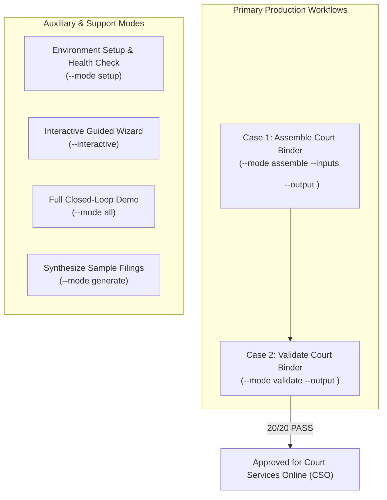

# AGENTS.md — Developer & AI Agent Guidelines for bc-court-binder

This file binds every human contributor and AI coding agent working in this repository. It defines environment setup, dependency management, execution workflows, and compliance quality gates.

---

## 1. Project Mission & Architecture

`bc-court-binder` is an enterprise legal-ops compilation and pre-flight auditing pipeline for the Supreme Court of British Columbia and the Court of Appeal for British Columbia. It automates:
1. **Form 22 Style of Cause Title Page** (Item 1)
2. **Columnar Legal Index Table** (Item 2) with invisible rectangle GoTo hyperlinks
3. **Continuous Top-Center Folio Stamping** ($15\text{ pt}$ Bold Arial/Helvetica)
4. **Hierarchical Bookmarks Panel** with party disambiguation and nested exhibits
5. **Digital Page Labels (`/PageLabels`)** synchronized with visual folios
6. **Pre-Flight Compliance Auditing** against 20 statutory quality gates

---

## 2. Dependency Setup: Consuming the PdfCraft SDK

This repository consumes the core document processing engine from [`richfrem/pdfcraft`](https://github.com/richfrem/pdfcraft).

### 2.1 Python Environment (Primary for Agent Skills)
Agents and scripts run under Python 3.9+.

```bash
# 1. Initialize virtual environment
python3 -m venv .venv
source .venv/bin/activate  # On Windows: .venv\Scripts\Activate.ps1

# 2. Install dependencies and native PdfCraft SDK
pip install -r requirements.txt
```

#### How `requirements.txt` Resolves the Native SDK:
`requirements.txt` automatically resolves the pre-compiled native PyO3 wheel from the latest engine release based on your operating system:
* **macOS (Apple Silicon arm64)**: `pdfcraft-0.5.0-cp313-cp313-macosx_11_0_arm64.whl`
* **Windows (win_amd64)**: `pdfcraft-0.5.0-cp313-cp313-win_amd64.whl`
* **Fallback / Development Source**: If pre-compiled wheels are not yet reachable, agents fall back to pure-Python/pypdf vector operations or local pip install:
  ```bash
  pip install "git+https://github.com/richfrem/pdfcraft.git#subdirectory=sdks/python"
  ```

### 2.2 Rust Environment (Optional CLI & SDK Runner)
When executing or modifying Rust code in `src/main.rs`:

```toml
[dependencies]
pdfcraft-sdk = { git = "https://github.com/richfrem/pdfcraft", branch = "main" }
tokio = { version = "1", features = ["macros", "rt-multi-thread"] }

# Local development override (when working side-by-side with local pdfcraft clone):
[patch."https://github.com/richfrem/pdfcraft"]
pdfcraft-sdk = { path = "../pdfcraft/crates/sdk" }
```

Build and execute:
```bash
cargo check
cargo run
```

---

## 3. Agent Tool & Skill Execution Workflows

Agents must use the consolidated `.apm/skills/managing-court-binders` skill to inspect, generate, assemble, and validate binders headlessly:



### 3.1 Primary Operational Workflows:

#### Case 1: Assemble Court Binder (Most Common)
```bash
python3 .apm/skills/managing-court-binders/scripts/managing_court_binders.py \
  --mode assemble \
  --inputs inputs/01-commercial-discovery \
  --output output/01-commercial-discovery/Application_Record.pdf
```

#### Case 2: Validate / Audit Court Binder Submission (Most Common)
```bash
python3 .apm/skills/managing-court-binders/scripts/managing_court_binders.py \
  --mode validate \
  --output output/01-commercial-discovery/Application_Record.pdf
```

To obtain structured machine-readable JSON for agent receipt verification:
```bash
python3 .apm/skills/managing-court-binders/scripts/managing_court_binders.py \
  --mode validate \
  --output output/01-commercial-discovery/Application_Record.pdf \
  --json
```

#### Case 3: Interactive Wizard & Environment Verification
```bash
# Verify environment dependencies & auto-install missing packages
python3 .apm/skills/managing-court-binders/scripts/managing_court_binders.py --mode setup

# Run the interactive guided terminal wizard
python3 .apm/skills/managing-court-binders/scripts/managing_court_binders.py --interactive

# Run the complete closed-loop lifecycle (generate -> assemble -> audit)
python3 .apm/skills/managing-court-binders/scripts/managing_court_binders.py --mode all
```

### 3.2 Agent Knowledge Base & Reference Structure
All legal domain rules, procedural instructions, and former skills have been consolidated under [`.apm/skills/managing-court-binders/references/`](.apm/skills/managing-court-binders/references/). When an agent needs deep domain context, it must consult these references directly:

| Task / Domain Query | Reference File | What It Contains |
| :--- | :--- | :--- |
| **Assembly, Folios & Links** | [`references/assembling-court-binders.md`](.apm/skills/managing-court-binders/references/assembling-court-binders.md) | Pass 1 folio math, Pass 2 coordinate projection, `/Border [0 0 0]` invisible links, `/PageLabels`. |
| **Compliance & 20 Quality Gates** | [`references/validating-court-binders.md`](.apm/skills/managing-court-binders/references/validating-court-binders.md) | 20-gate implementation rules, 3-tier severity (`HARD_STOP`, `SOFT_WARNING`), OCR entropy ($H \ge 3.0$). |
| **Filing Synthesis & Drafting** | [`references/generating-court-documents.md`](.apm/skills/managing-court-binders/references/generating-court-documents.md) | Form 32, Form 33, Form 35 layout, manifest schema, and synthetic filing generator. |
| **LLM Chambers Drafting Prompts** | [`references/prompts/generate_bc_chambers_filings_prompt.md`](.apm/skills/managing-court-binders/references/prompts/generate_bc_chambers_filings_prompt.md) | System prompt for LLM drafting of commercial discovery, amendment, and family filings. |
| **Environment Setup & Wheels** | [`references/environment-setup.md`](.apm/skills/managing-court-binders/references/environment-setup.md) | Virtualenv, pip requirements, pre-built native wheel install, and optional Rust setup. |
| **Official CSO Rules (April 2026)** | [`references/cso_application_record_guide_april2026.md`](.apm/skills/managing-court-binders/references/cso_application_record_guide_april2026.md) | The April 2026 CSO Guide for submitting application records electronically. |
| **Practice Directions** | [`references/court_practice_directions.md`](.apm/skills/managing-court-binders/references/court_practice_directions.md) | Practice Direction 72 (PD-72) and Practice Direction 73 (PD-73) text and rules. |
| **Paralegal Workflow Analysis** | [`references/paralegal_video_workflow.md`](.apm/skills/managing-court-binders/references/paralegal_video_workflow.md) | Transcript and breakdown of the Senior Vancouver Paralegal 9-step manual workflow. |
| **Court PDF Technical Guides** | [`references/pdf_instructions.md`](.apm/skills/managing-court-binders/references/pdf_instructions.md) | Analysis of all 13 official Supreme Court PDF instructions. |

---

### 3.3 Desktop App (`app/`)

A local desktop app (pywebview + HTML/CSS/JS) exposes three functions: create synthetic filings and run a full cycle, build a binder from a user-chosen folder, and validate a user-chosen PDF.

* **Engine is the skill.** `app/binder_app/engine.py` imports the scripts in `.apm/skills/managing-court-binders/scripts/`. Never copy or reimplement generate, assemble or validate logic in `app/`; change the skill instead.
* **Do not put app code under `.apm/`.** APM manages that folder and may overwrite it.
* **Design system.** UI uses BC Sans and tokens from the `bc-gov-design-system` skill only (no raw hex, no other fonts, sentence case, visible focus ring, acknowledgment footer). Dynamic text is set with `textContent`, never `innerHTML`.
* **Coding conventions.** Python files carry the standard header, full type hints, dual-layer docs, and functions under 50 lines.
* **Manifest.** `generate_discovery_preset()` only returns the manifest; callers must write `manifest.json` or the assembler cannot create exhibit bookmarks. The skill's `--mode all` and the app adapter both do this now (20 / 20).
* **Verify before claiming done:** `cd app && python -m unittest discover -s tests -t .` must pass with all 20 gates green.
* **Run it:** `cd app && python -m binder_app.main` (see [`INSTALL.md`](INSTALL.md#option-4-desktop-app)).
* **Case details.** The title page uses the registry, court file number, parties and hearing date (time estimate and counsel are optional and omitted when blank). The app treats all of them as optional and warns about remaining placeholders; agents should still ask the user for them. A `000_Application_Record_Title_Page.txt` in the filings folder replaces the generated title page. They live in `manifest.json`; the skill's `read_case_details`, `save_case_details` and `suggest_binder_name` (in `assembling_court_binders.py`) and the `--registry`, `--file-number`, `--plaintiff`, `--defendant`, `--hearing-date` (and optional `--time-estimate`) options are the single implementation used by agents, the CLI and the app. Never invent or reuse sample values (such as `S-240123`); ask the user.
* **True copies.** A filing that is a readable PDF must reach the binder as its original pages (see `splice_original_pages` in `assembling_court_binders.py`); do not typeset PDFs from extracted text. Only text-only filings are typeset, with a warning. Exhibits are child bookmarks, the index may span several pages, and the validator derives the front-matter size from `/PageLabels`; keep the tests in `TrueCopyTest` passing.
* **CSO filing help.** Agents and the app guide users through registering, logging on, registering a card and e-filing using `references/cso-account-and-efiling.md` and `references/cso_links.json`. Guide only: never enter, request or store credentials, card or payment details, never register accounts or submit for the user, and never put case details in URLs. Only open addresses listed in `cso_links.json`; re-verify them when CSO changes.
* **Installers.** `packaging/macos/` builds the `.dmg`. If you add a file the app loads at run time (new skill script, reference file, UI asset), add it to `binder_app.spec`, and keep `Court binder builder --selftest` passing; the build fails if the bundle is broken. Never commit the built `.dmg`. The PdfCraft wheel is pinned by URL and SHA-256 in `build_dmg.sh`; update both together, and note the engine does not call PdfCraft yet.
* `src/main.rs` is a separate Rust prototype, not part of the app.

---

## 4. Quality Invariants: The 20 Mandatory Court Gates

A change is **not done** and must **never be committed** if any court quality gate fails:

- `RULE-00` (**HARD_STOP**): Document must be unencrypted without password protection.
- `RULE-01` (**HARD_STOP**): Must be a single consolidated PDF volume.
- `RULE-02` (**HARD_STOP**): File size must not exceed $50.0\text{ MB}$ ($52,428,800\text{ bytes}$).
- `RULE-03` (**SOFT_WARNING**): Initial View must set `/PageMode /UseOutlines` to display bookmarks by default.
- `RULE-04` (**HARD_STOP**): Item 1 must be Form 22 / Form 30.001 Style of Cause Title Page.
- `RULE-05` (**HARD_STOP**): Item 2 must be the Numbered Index positioned before substantive tabs.
- `RULE-06` (**HARD_STOP**): Every listed item in the Index must feature exact calculated page folios.
- `RULE-07` (**SOFT_WARNING**): Index entries must have active `/Subtype /Link` annotations.
- `RULE-08` (**SOFT_WARNING**): Link appearance must be `Invisible Rectangle` (`/Border [0 0 0]`), Highlight: `None` (`/H /N`).
- `RULE-09` (**SOFT_WARNING**): Links must feature universal GoTo actions (`/A << /S /GoTo /D [target R /FitH 792] >>`) jumping to top view.
- `RULE-10` (**HARD_STOP**): Page numbers must be stamped top-center ($x \approx 290\text{ pt}, y \approx 760\text{ pt}$, within top $100\text{ pt}$ margin).
- `RULE-11`–`RULE-13` (**SOFT_WARNING**): Page numbers must use Arial/Helvetica Bold, $14\text{--}16\text{ pt}$.
- `RULE-14` (**HARD_STOP**): Printed folio `1` must begin on Tab 1 (Notice of Application); Title Page & Index are unnumbered.
- `RULE-15` (**HARD_STOP**): Catalog `/PageLabels` must be synchronized with visual folios.
- `RULE-16` (**SOFT_WARNING**): Front matter page labels set to `None` (`0 << >>`).
- `RULE-17` (**HARD_STOP**): Bookmarks must be descriptive with party names; generic titles (`Page 1`, `Scan 001`) are rejected.
- `RULE-18` (**HARD_STOP**): Affidavit exhibits must be nested as child bookmarks; vector text must pass Shannon character entropy ($H \ge 3.0$); legal authorities must be included as full-text PDF pages (never external web links).
- `RULE-19` (**SOFT_WARNING**): Pages must conform to standard North American Letter dimensions ($8.5 \times 11\text{ inches}$, $612 \times 792\text{ pt}$).

---

## 5. Security, Clean-Room & Privacy Policies

1. **Synthetic Fixtures Only**: Never commit real litigant PII, confidential case materials, real bank statements, or sensitive court filings. All test cases must use synthetic, fictitious parties and docket numbers.
2. **Never Crash**: Ingestion of malformed PDFs or bad manifest arguments must return a descriptive `Result` or exit code with remediation advice—never an unhandled panic.
3. **Statutory Integrity**: Reference all court rules back to official publications in `.apm/skills/managing-court-binders/references/` (`PD-72`, `PD-73`, and the April 2026 CSO Guide).
