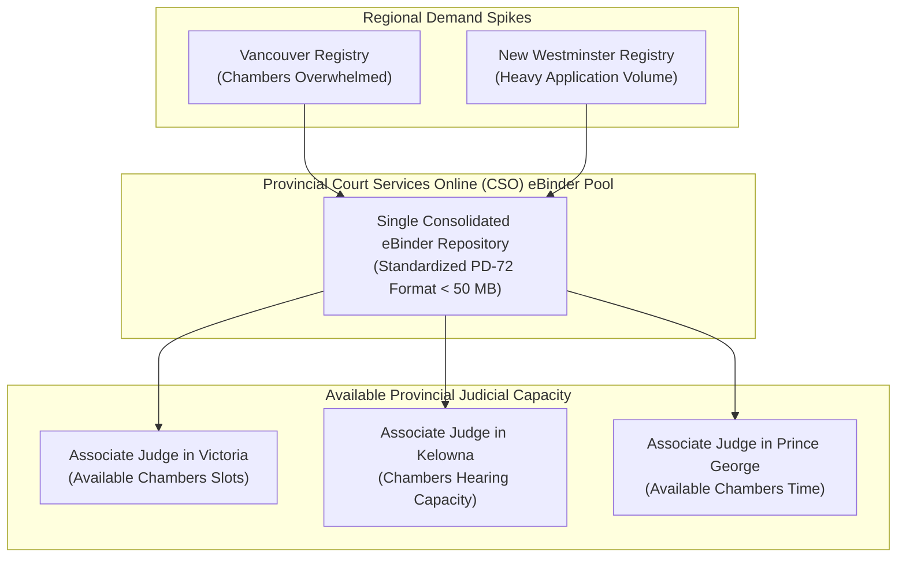

# Purpose & Institutional Benefits: Electronic Court Application Records (eBinders)
### Strategic Context for the BC Supreme Court Chambers Modernization Project

This document outlines the operational, institutional, economic, and access-to-justice purposes driving the **Supreme Court of British Columbia** and **Court Services Online (CSO)** toward mandatory electronic chambers application records (**eBinders**) under **Practice Direction 72 (PD-72)** and **Practice Direction 73 (Virtual Chambers)**.

---

## 🏛️ Executive Summary

For decades, Supreme Court chambers applications required physical 3-ring binders filled with paper pleadings, affidavits, and exhibits, delivered by courier to the court registry. 

The transition to standardized, searchable, hyperlinked **eBinders** represents an essential institutional modernization that directly addresses:
1. **Remote Judicial Access:** Enabling judges to preside from anywhere with complete, indexed digital files.
2. **Provincial Workload Balancing:** Shifting application records seamlessly between registries to utilize available judicial capacity and eliminate regional court backlogs.
3. **Emergency Filing Agility:** Allowing urgent applications from remote or underserved regions to be heard immediately by any available judge in British Columbia.
4. **Registry Staff Optimization:** Eliminating the immense clerical burden of handling, tracking, boxing, and storing heavy paper binders.
5. **Substantial Cost Savings:** Reducing legal fees, eliminating paper/binder materials, and avoiding courier and travel expenses for litigants.
6. **Hearing Velocity:** Increasing court throughput by enabling judges and counsel to navigate complex evidence in seconds through interactive bookmarks and hyperlinks.

---

## ⚖️ 1. Judicial Mobility & Remote Chambers Access

Under **Practice Direction 73 (Virtual Chambers)**, hearings scheduled for 30 minutes or less before an Associate Judge are conducted virtually by video (Microsoft Teams):

* **Immediate Access for Remote Judges:** When an Associate Judge presides from a home office, another registry, or while on circuit, they cannot physically pull paper binders from local registry shelves. A standardized eBinder provides immediate, secure access to the full evidentiary record.
* **Synchronized In-Hearing Navigation:** Physical page numbers often diverge from digital PDF reader counters, causing confusion during oral argument. The eBinder standardizes **top-center 14–16 pt bold folios** aligned with digital `/PageLabels`. When counsel says *"Please turn to page 12 of the Record, which is Exhibit B to the Affidavit"*, the judge clicks a single bookmark or index hyperlink and instantly views the identical page.
* **No Lost or Displaced Filings:** In paper records, supplementary affidavits filed late often fail to make it into the physical binder before the judge enters the courtroom. The eBinder consolidates the entire record into a single validated file before hearing commencement.

---

## 🌐 2. Provincial Workload Balancing & Inter-Registry Flexibility

One of the most transformative advantages of eBinders is **decoupling court capacity from geographic courthouse locations**:

### Key Operational Impacts:
* **Dynamic Capacity Allocation:** If the Vancouver or New Westminster registry has 40 chambers applications in a morning and cannot accommodate them all, unassigned matters can be dynamically transferred to an available Associate Judge sitting in Victoria, Kelowna, or Kamloops without mailing paper.
* **Facilitating Emergency Filings:** Urgent relief (e.g., interim preservation orders, emergency injunctions, substituted service) can be filed via CSO in a regional registry (e.g. Fort St. John or Cranbrook) and heard the same afternoon by an available judge in Vancouver.
* **Resilience to Extreme Weather & Travel Disruptions:** In winter months, judicial travel to regional circuit registries is frequently disrupted by weather. Electronic binders allow proceedings to continue uninterrupted via Virtual Chambers.

---

## 📂 3. Court Registry Staff & Operational Efficiencies

Managing physical application records is one of the most labour-intensive workflows in the justice system:

* **Eliminating Clerical Handling:** Registry staff previously spent thousands of hours annually receiving, unboxing, inspecting, physically stamping, hand-sorting, and boxing 3-ring binders.
* **Eliminating Physical Storage & Shredding:** Courthouses previously maintained rooms of shelving to store application records pending hearing dates, followed by physical returns to counsel or post-hearing shredding. eBinders require zero physical shelf space.
* **Instant Rejection/Acceptance Validation:** Using programmatic validation gates (such as the [`validating-court-binders`](.apm/skills/validating-court-binders) skill), registry clerks can verify in seconds whether a filing satisfies PD-72 rules before accepting it, preventing defective files from ever reaching the judge.

---

## 💰 4. Direct Cost Savings for Litigants & Law Firms

The traditional paper application record imposed severe financial friction on clients:

| Cost Factor | Traditional Paper Application Record | Automated eBinder Pipeline (`pdfcraft-sdk`) |
| :--- | :--- | :--- |
| **Printing & Copying** | 3 to 4 paper copies of 200–500 pages (Judge, Clerk, Counsel, Client) = 1,000+ pages per application ($200–$500 in print costs). | **$0** (100% digital, zero printing). |
| **Binder Materials** | Heavy-duty 3-ring binders, index tabs, plastic exhibit divider sheets ($30–$75 per set). | **$0** (Zero physical stationery). |
| **Courier & Delivery** | Same-day process servers and couriers delivering 20 lb boxes to registries across BC ($50–$250 per delivery). | **$0** (Instant electronic submission via CSO). |
| **Paralegal Assembly** | 45–90 minutes of billable paralegal time manually compiling, numbering, and tabbing ($150–$350 in legal fees). | **< 200 milliseconds** automated build via software ($0 in billable assembly time). |
| **Counsel Travel Time** | 2 to 4 hours of lawyer travel and courthouse waiting time for a 15-minute hearing ($750–$2,000 in fees). | Counsel appears virtually from their office; client pays only for the actual hearing time. |

> **Net Impact on Access to Justice:** Total cost savings per chambers application frequently reach **$1,000 to $3,000 for everyday British Columbians**, lowering barriers to accessing the courts.

---

## 🌱 5. Environmental Sustainability

* **Tens of Millions of Pages Saved:** With tens of thousands of chambers applications heard annually across British Columbia, transitioning to eBinders saves whole forests of paper and prevents tons of plastic ring-binders from entering provincial landfills.
* **Carbon Reduction:** Eliminating physical document courier trips and attorney vehicular travel across regional courthouses drastically lowers the justice system's carbon footprint.

---

## 🚀 6. Hearing Velocity: Hearing More Matters More Efficiently

* **Immediate Cross-Referencing:** Instead of shuffling through thick paper binders to find an exhibit, the judge and counsel click bookmarks or index hyperlinks, reducing hearing dead-time.
* **Higher Docket Density:** Chambers lists move faster. Applications estimated for 30 minutes can conclude in 15–20 minutes, allowing registries to schedule more matters per sitting day and reducing overall judicial backlog.
