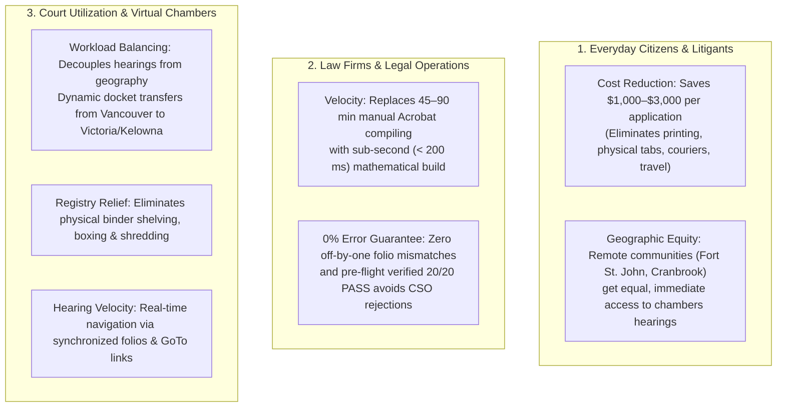

# BC Court Electronic Binder Builder

[](#the-20-mandatory-court-quality-gates)
[-blue)](#key-technical-documentation)
[](https://github.com/richfrem/pdfcraft)

An automated legal-ops pipeline for compiling, stamping, bookmarking, and validating **Electronic Application Records** and **Books of Authorities** for the Supreme Court of British Columbia and the Court of Appeal for British Columbia.

Strictly adheres to:
* **Practice Direction 72 (PD-72)**: *Electronic Application Records* — [Live Official PDF](https://www.bccourts.ca/supreme_court/practice_and_procedure/practice_directions/civil/PD-72_Electronic_Application_Records.pdf) • [Local Archive](.apm/skills/managing-court-binders/references/pdfs/PD-72_Electronic_Application_Records.pdf) • [Analysis](.apm/skills/managing-court-binders/references/court_practice_directions.md)
* **Practice Direction 73 (PD-73)**: *Virtual Chambers & Microsoft Teams Hearings* — [Live Official PDF](https://www.bccourts.ca/supreme_court/practice_and_procedure/practice_directions/civil/PD-73_Virtual_Chambers.pdf) • [Local Archive](.apm/skills/managing-court-binders/references/pdfs/PD-73_Virtual_Chambers.pdf)
* **Court Services Online (CSO)**: *Guide to Submitting Application Records (April 2026 Edition)* — [CSO Portal](https://justice.gov.bc.ca/cso/) • [Local Archive](.apm/skills/managing-court-binders/references/pdfs/InstructionsForUsersForApplicationRecords.pdf) • [Analysis](.apm/skills/managing-court-binders/references/cso_application_record_guide_april2026.md)
* **BCCA Civil Rule 27**: *Completion Instructions for Books of Authorities* — [Live Official PDF](https://www.bccourts.ca/Court_of_Appeal/practice_and_procedure/completion_instructions/civil/e_completion_instructions_book_of_authorities.pdf) • [Local Archive](.apm/skills/managing-court-binders/references/pdfs/e_completion_instructions_book_of_authorities.pdf)
* **Paralegal Best Practices**: *Vancouver Senior Paralegal 9-Step Standard* — [Vimeo Training Video (ID 836310097)](https://vimeo.com/836310097) • [Video Analysis & Transcript](.apm/skills/managing-court-binders/references/paralegal_video_workflow.md)
* **BC Supreme Court PDF Guides**: *All 13 Acrobat Technical Instruction Manuals* — [Court Practice & Procedure Portal](https://www.bccourts.ca/supreme_court/practice_and_procedure/pdf_instructions.aspx) • [Technical Breakdown](.apm/skills/managing-court-binders/references/pdf_instructions.md)

---

## 🏛️ Strategic Purpose & Institutional Benefits: Enabling Virtual Courts

For the complete legal-economic policy analysis, read: 👉 **[`COURT_PURPOSE_AND_BENEFITS.md`](COURT_PURPOSE_AND_BENEFITS.md)**.

Modernizing court records from physical 3-ring paper binders to mathematically verified, hyperlinked **eBinders** unlocks three transformative pillars for British Columbia's justice system:



### Key Beneficiary Impact Matrix:

1. **For Everyday Citizens & Litigants (Access to Justice):**
   * **Direct Legal Cost Reduction:** Traditional chambers applications required 3 to 4 paper volumes (1,000+ pages), custom tab dividers, couriers, and multiple hours of lawyer travel and court waiting time. eBinders reduce non-legal clerical costs to **$0**, saving litigants **$1,000 to $3,000 per application**.
   * **Elimination of Geographic Barriers:** Litigants in rural or northern BC communities no longer need to pay thousands of dollars for counsel to travel to regional judicial centers; applications are heard virtually via MS Teams (PD-73).

2. **For Law Firms & Paralegals (Zero Friction Automation):**
   * **Replaces Tedious Manual Assembly:** Paralegals spend 45 to 90 minutes per filing manually dragging-and-dropping PDFs in Adobe Acrobat, setting page labels, calculating table of contents numbers, and drawing invisible link rectangles. This engine executes the full synthesis in **< 200 milliseconds**.
   * **Guaranteed First-Time Acceptance:** Pre-flight compliance auditing against the 20 court quality gates prevents embarrassing registry rejections and costly hearing adjournments.

3. **For the Court System & Virtual Chambers Utilization:**
   * **Provincial Workload Balancing:** When the Vancouver or New Westminster registry has 40+ chambers applications on a morning list and cannot accommodate them, Court Services Online can dynamically route electronic application records to available Associate Judges in Victoria, Kelowna, or Prince George without courier delays.
   * **Registry Operations Optimization:** Courthouses eliminate warehouse rooms dedicated to storing heavy 3-ring binders pending hearings and post-hearing shredding. Registry clerks use automated validation gates to pre-flight filings in seconds.
   * **Virtual Hearing Velocity:** In MS Teams hearings, when counsel says *"Please turn to page 14 of the Record, which is Exhibit B to the Affidavit"*, the judge clicks a single bookmark or index hyperlink and instantly views the identical page, avoiding disorientation during 30-minute hearings.

---

## 📚 Key Technical Documentation

* **[`architecture.md`](architecture.md):** System architecture, legal taxonomy of submittable chambers matters (< 30 minutes before Associate Judges), component layering, and the consolidated skill specification.
* **[`BC_ELECTRONIC_BINDER_SPEC.md`](BC_ELECTRONIC_BINDER_SPEC.md):** Complete synthesis of the 9-step paralegal manual workflow (from Senior Vancouver Paralegal Video 836310097) vs. the automated SDK pipeline.
* **[`managing-court-binders/references/`](.apm/skills/managing-court-binders/references/):** Consolidated, self-contained library containing procedural sub-skill manuals, environment setup guides, official court practice directions (`PD-72`, `PD-73`), the April 2026 CSO Guide, 18 source court PDFs, and all 13 BC Supreme Court PDF technical instruction guides.

---

## 🤖 Consolidated Agent Skill (`.apm/skills/managing-court-binders`)

This repository encapsulates all legal-ops capabilities into a single, self-contained APM domain skill: **[`managing-court-binders`](.apm/skills/managing-court-binders)**.

### Operational Modes

| Mode | Priority / Use Case | Operational Function | Command |
| :--- | :--- | :--- | :--- |
| **`assemble`** | **Case 1 (Primary)** | Ingests source documents, calculates two-pass folios, builds Form 22 Title Page and 4-column Index, stamps top-center folios, sets `/PageLabels`, and injects `/Border [0 0 0]` invisible hyperlinks. | `python3 scripts/managing_court_binders.py --mode assemble` |
| **`validate`** | **Case 2 (Primary)** | Audits candidate PDF against the 20 statutory court quality gates (CSO 50 MB, outlines, margins, OCR entropy). | `python3 scripts/managing_court_binders.py --mode validate` |
| **`interactive`** | Guided Wizard | Launches interactive terminal menu prompting the operator for desired workflow and file paths. | `python3 scripts/managing_court_binders.py --interactive` |
| **`setup`** | Diagnostics & Install | Verifies Python runtime, pip dependencies (`pypdf`, `pdfplumber`), native PyO3 wheel, and Rust toolchain; auto-installs missing packages. | `python3 scripts/managing_court_binders.py --mode setup` |
| **`all`** | Closed-Loop Demo | Full automated loop: synthesizes test filings $\to$ compiles binder $\to$ executes 20-gate compliance audit. | `python3 scripts/managing_court_binders.py --mode all` |
| **`generate`** | Test Data Synthesis | Synthesizes authentic multi-page chambers filings (`discovery`, `amendment`, `family`) and companion `manifest.json`. | `python3 scripts/managing_court_binders.py --mode generate` |

### Key Reference Manuals (`references/`)

All domain knowledge is modularized inside [`.apm/skills/managing-court-binders/references/`](.apm/skills/managing-court-binders/references/):
* **Procedural Sub-Skill References:**
  * [`assembling-court-binders.md`](.apm/skills/managing-court-binders/references/assembling-court-binders.md) — Two-pass foliation math, coordinate projection, `/Border [0 0 0]` invisible links, `/PageLabels`.
  * [`validating-court-binders.md`](.apm/skills/managing-court-binders/references/validating-court-binders.md) — 20-gate compliance auditing engine, 3-tier severity (`HARD_STOP`, `SOFT_WARNING`), OCR entropy ($H \ge 3.0$).
  * [`generating-court-documents.md`](.apm/skills/managing-court-binders/references/generating-court-documents.md) — Supreme Court Forms 32, 33, and 35 filing generator and manifest schemas.
  * [`environment-setup.md`](.apm/skills/managing-court-binders/references/environment-setup.md) — Runtime environment verification, pip dependencies, native PyO3 wheel, and Rust toolchain setup.
  * [`prompts/generate_bc_chambers_filings_prompt.md`](.apm/skills/managing-court-binders/references/prompts/generate_bc_chambers_filings_prompt.md) — High-density LLM prompt template for drafting chambers filings.
* **Official Court Standards & Manuals:**
  * [`cso_application_record_guide_april2026.md`](.apm/skills/managing-court-binders/references/cso_application_record_guide_april2026.md) — Court Services Online (CSO) April 2026 guidelines.
  * [`court_practice_directions.md`](.apm/skills/managing-court-binders/references/court_practice_directions.md) — Practice Direction 72 (PD-72) and Practice Direction 73 (PD-73).
  * [`paralegal_video_workflow.md`](.apm/skills/managing-court-binders/references/paralegal_video_workflow.md) — Senior Vancouver Paralegal 9-step manual workflow transcript & analysis.
  * [`pdf_instructions.md`](.apm/skills/managing-court-binders/references/pdf_instructions.md) — Technical analysis of all 13 official Supreme Court PDF instructions.

---

## ⚖️ The 20 Mandatory Court Quality Gates

Every assembled binder is audited against 20 deterministic rules:

1. `RULE-00` (**Hard Stop**): Security & Encryption Disabled (no passwords).
2. `RULE-01` (**Hard Stop**): Single Consolidated PDF File (valid `%PDF-1.7` & `%%EOF`).
3. `RULE-02` (**Hard Stop**): CSO 50 MB File Size Ceiling Audit.
4. `RULE-03` (**Soft Warning**): Initial View Bookmarks Panel Default (`/PageMode /UseOutlines`).
5. `RULE-04` (**Hard Stop**): Form 22 / Form 30.001 Style of Cause Title Page (Item 1).
6. `RULE-05` (**Hard Stop**): Numbered Index / Table of Contents as Item 2.
7. `RULE-06` (**Hard Stop**): Exact Calculated Page Folios in Index.
8. `RULE-07` (**Soft Warning**): Hyperlinked Index Items (`/Subtype /Link`).
9. `RULE-08` (**Soft Warning**): Link Visual Appearance: Invisible Rectangle (`/Border [0 0 0]`), Highlight Style: None (`/H /N`).
10. `RULE-09` (**Soft Warning**): Universal GoTo Navigation Action (`/A << /S /GoTo /D [...] >>` & `/Dest`).
11. `RULE-10` (**Hard Stop**): Spatial Margin Top-Center Folio Placement ($x \approx 290\text{ pt}, y \approx 760\text{ pt}$).
12. `RULE-11` (**Soft Warning**): Folio Font Family (Standard-14 Arial/Helvetica).
13. `RULE-12` (**Soft Warning**): Folio Font Style (Bold).
14. `RULE-13` (**Soft Warning**): Folio Font Size ($14\text{--}16\text{ pt}$).
15. `RULE-14` (**Hard Stop**): Visible Page 1 Starts on Substantive Content (Notice of Application).
16. `RULE-15` (**Hard Stop**): Digital `/PageLabels` Synchronization with visual folios.
17. `RULE-16` (**Soft Warning**): Unnumbered Front Matter (`None` scheme for Title Page & Index).
18. `RULE-17` (**Hard Stop**): Meaningful Bookmarks with Party Disambiguation.
19. `RULE-18` (**Hard Stop**): Nested Exhibit Sub-Bookmarks, Searchable Vector/OCR Text ($H \ge 3.0$), and Full-Text Authorities Included.
20. `RULE-19` (**Soft Warning**): Standard North American Letter Page Geometry ($8.5 \times 11\text{ inches}$).

---

## 🚀 Quick Start

### 1. Python Pipeline (Fast, Zero Compiler Setup)
```bash
# Install dependencies
pip install -r requirements.txt

# Case 1 (Most Common): Assemble an electronic court binder from input filings
python3 .apm/skills/managing-court-binders/scripts/managing_court_binders.py \
  --mode assemble \
  --inputs inputs/01-commercial-discovery \
  --output output/01-commercial-discovery/Application_Record.pdf

# Case 2 (Most Common): Audit / validate an assembled binder PDF against the 20 quality gates
python3 .apm/skills/managing-court-binders/scripts/managing_court_binders.py \
  --mode validate \
  --output output/01-commercial-discovery/Application_Record.pdf

# Case 3: Verify environment & automated dependency install
python3 .apm/skills/managing-court-binders/scripts/managing_court_binders.py --mode setup

# Case 4: Run the interactive wizard or full closed-loop demo
python3 .apm/skills/managing-court-binders/scripts/managing_court_binders.py --interactive
python3 .apm/skills/managing-court-binders/scripts/managing_court_binders.py --mode all
```

### 2. Rust Pipeline (Native `pdfcraft-sdk` Reference Engine)

The Rust runner in [`src/main.rs`](src/main.rs) is the native reference implementation that directly integrates with the in-process [`pdfcraft-sdk`](https://github.com/richfrem/pdfcraft) crate (`Layer 7`). It demonstrates how to build and verify a court application record without external CLI utilities.

#### What `cargo run` Does:
1. **In-Memory Legal Case Synthesis:** Instantiates a 5-document commercial discovery case (*Notice of Application*, *Application Response*, *Affidavit #1 of Eleanor Vance with Exhibits A & B*, *Draft Order*, and *Kalin v. Campbell* authority).
2. **Dynamic Folio & Index Math:** Calculates exact folio target coordinates starting at **Page 1 on Tab 1** (leaving Title & Index unnumbered per Rule 16).
3. **Vector PDF Generation:** Generates the Title page and 4-column Index table (`TAB`, `DOCUMENT`, `FILED DATE`, `PAGE`) with invisible rectangle GoTo hyperlinks (`/Border [0 0 0]`, `/H /N`).
4. **Folio Stamping & Digital Metadata:** Injects $15\text{ pt}$ Bold Helvetica top-center page folios, sets `/PageLabels`, and configures Initial View (`/PageMode /UseOutlines`).
5. **PdfCraft SDK Verification:** Calls `pdfcraft_sdk::LocalClient::default().render_page(&src, 1, ...)` to mathematically verify that the PdfCraft rasterization engine renders Page 1 without syntax errors.
6. **CSO Audit & File Output:** Audits the generated PDF against the $50\text{ MB}$ Court Services Online limit and writes the file.

```bash
# Prerequisites: Rust 1.80+ (https://rustup.rs or `curl --proto '=https' --tlsv1.2 -sSf https://sh.rustup.rs | sh`)
# Execute the native Rust pipeline
cargo run
```

#### Output Artifact:
```text
output/01-commercial-discovery/Application_Record_Commercial_Document_Discovery_Rule_7-1_15Nov2026.pdf
```

#### Sample Terminal Output:
```text
================================================================================
   BRITISH COLUMBIA ELECTRONIC APPLICATION RECORD BUILDER (PD-72 & CSO POC)     
   Synthesized from BC Court Rules, CSO User Guides & Senior Paralegal Practice 
================================================================================

Step 1: Ingesting source documents and exhibit metadata...
Step 2: Calculating dynamic page numbering, folios, and bookmarks...
   -> Front matter: 2 pages (Title page + dynamic Index)
   -> Tab 1 starts at visible Page 1 (foliated continuous)
   -> Total substantive content: 15 pages across 5 items
   -> Total application record size: 17 pages
Step 3: Generating PDF byte stream with vector layout...
Step 4: Compiling hierarchical bookmark outline tree and link annotations...
Step 5: Verifying PDF with PdfCraft LocalClient...
   -> PdfCraft engine raster verification passed: Page 1 rendered successfully
Step 6: Executing CSO pre-flight compliance audit...

SUCCESS: Compliant Electronic Application Record generated!
  File Path: output/01-commercial-discovery/Application_Record_Commercial_Document_Discovery_Rule_7-1_15Nov2026.pdf
  File Size: 18.42 KB (0.0176 MB)
  CSO Audit: PASS (Within strict 50 MB Court Services Online ceiling)

=== Professional Paralegal Workflow Checklist (Video 836310097) ===
✔ [Step 1] Source PDFs ingested with logical sequence order.
✔ [Step 2] Content compiled into single continuous PDF stream.
✔ [Step 3] Bookmarks panel populated with clear titles and exhibit sub-bookmarks.
✔ [Step 4] Top-center 14-16pt bold page numbers stamped across content pages.
✔ [Step 5] Title page & dynamic Index generated with accurate calculated folios.
✔ [Step 6] Text searchability verified (ready for OCR layer).
✔ [Step 7] Visual folios align precisely with index numbers.
✔ [Step 8] Hyperlink structure verified from Index entries to targets.
✔ [Step 9] File size audited and verified under 50 MB threshold.
```

---

### 💡 Which Pipeline Should I Use?

| Feature | Python Pipeline (`.apm/skills/`) | Rust Pipeline (`cargo run`) |
| :--- | :--- | :--- |
| **Primary Use Case** | Day-to-day legal operations, batch processing, and AI Agent execution | Core engine development and SDK integration testing |
| **Input Source** | Dynamic JSON manifests & arbitrary PDFs (`inputs/<scenario>/`) | Hardcoded commercial discovery test case in `src/main.rs` |
| **Startup Time** | Instant (< 1 second) | Requires initial `cargo build` compilation |
| **Disk Requirement** | Lightweight (< 1 MB cache) | Generates compiler cache in `target/` (~1 GB) |
| **Customizability** | Drop any PDF or exhibit into `inputs/` | Edit Rust structs in `src/main.rs` |

---

## 📄 License
Dual-licensed under MIT or Apache-2.0.
