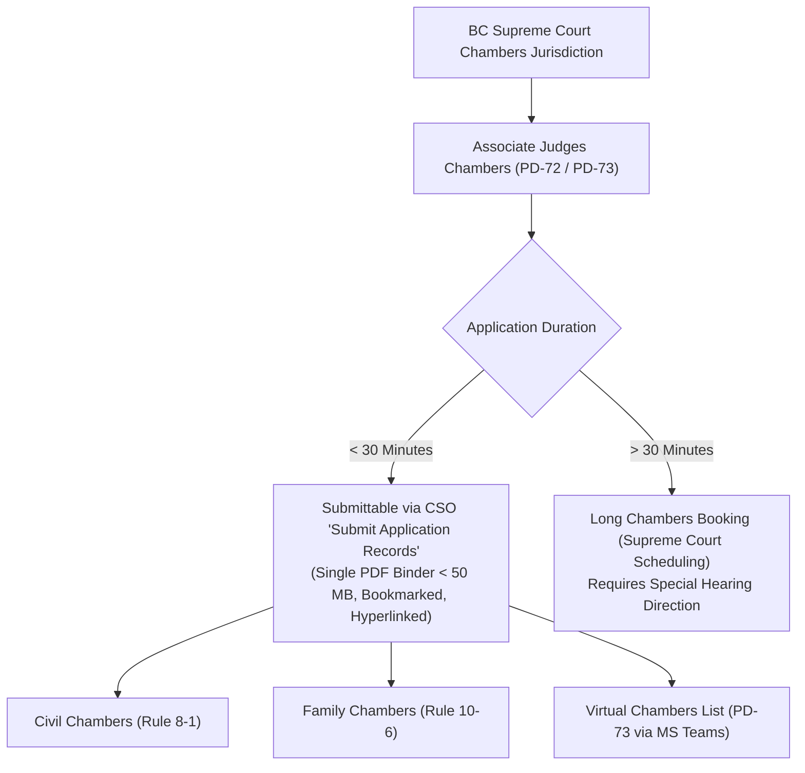
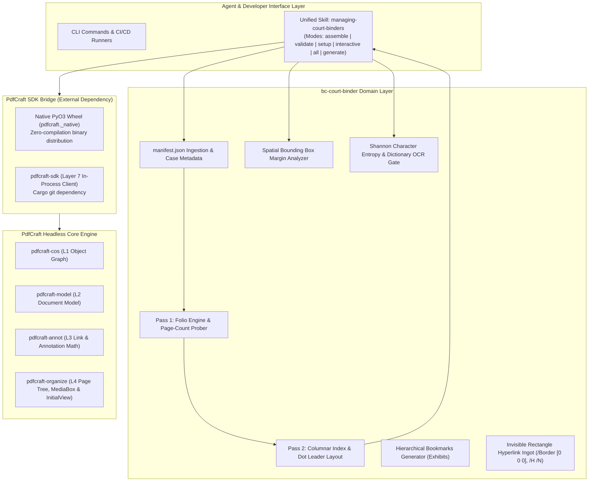
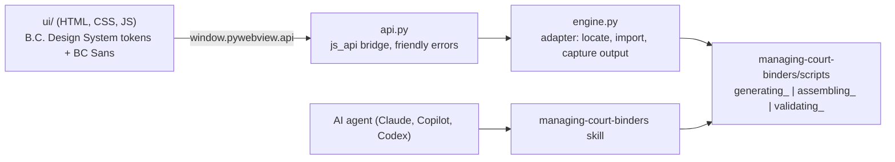

# Architecture: Electronic Court Binder Processing Engine
### Standalone Legal-Ops Domain Pipeline & Pre-Flight Compliance Engine

This document details the architectural design, component layers, legal taxonomy, and pre-flight auditing model of **`bc-court-binder-builder`**. It describes how the high-level legal procedural taxonomy interfaces with the underlying document processing engine ([`richfrem/pdfcraft`](https://github.com/richfrem/pdfcraft) / upstream [`storytold/pdfcraft`](https://github.com/storytold/pdfcraft)) and the foundational court compliance models originally developed in the Ministry of Attorney General repository [`bcgov-c/jag-cso-assistant`](https://github.com/bcgov-c/jag-cso-assistant) to assemble, stamp, bookmark, and validate electronic court binders submitted via Court Services Online (CSO).

---

## 🏛️ 1. Legal Domain & Submittable Matters Taxonomy

### 1.1 Legislative and Administrative Framework
Under the *Supreme Court Civil Rules* (B.C. Reg. 168/2009), the *Supreme Court Family Rules* (B.C. Reg. 169/2009), **Practice Direction 72 (PD-72)**, and **Practice Direction 73 (PD-73)**, the Supreme Court of British Columbia authorizes electronic filing of chambers application records for matters scheduled before an **Associate Judge in Chambers**.



### 1.2 Eligible / Submittable Matter Types (30 Minutes or Less)
The electronic binder builder is engineered to synthesize materials for all qualifying interlocutory applications heard in Associate Judges Chambers:

1. **Document Discovery & Disclosure (Civil Rule 7-1):**
   * Applications for supplementary lists of documents (Rule 7-1(11)).
   * Applications for production of specific documents or unredacted inspection (Rule 7-1(18)).
   * Setting terms for electronic discovery (ESI) protocols.
2. **Pleading Amendments & Particulars (Civil Rule 6-1 & 3-7):**
   * Applications for leave to amend Notice of Civil Claim, Response, or Counterclaim.
   * Demands for further and better particulars (Rule 3-7(23)).
   * Adding, deleting, or substituting parties (Rule 6-2(7)).
3. **Interlocutory Examinations (Civil Rule 7-2):**
   * Compelling answers to questions refused on examination for discovery.
   * Orders extending examination time limits beyond the standard 7 hours.
4. **Substituted Service & Case Administration (Civil Rule 4-4 & 3-2):**
   * Orders for substituted service (email, social media, posting).
   * Renewal of Notice of Civil Claim (Rule 3-2(1)).
5. **Family Law Interlocutory Relief (Family Rule 10-6):**
   * Interim child support and spousal support under the *Family Law Act* or *Divorce Act*.
   * Financial disclosure orders (Form F8 Financial Statements and Form 8.1 notices).
   * Interim parental responsibilities, parenting time, and contact orders.

### 1.3 Ineligible Matters (Exempted from PD-72 CSO Pilot)
* Applications estimated to take **more than 30 minutes** (must be scheduled through regular court scheduling).
* Applications within the exclusive jurisdiction of a **Justice** (e.g., summary trials under Rule 9-7, contempt of court, final orders, injunctions).
* Uncontested or consent order desks unless specifically directed into chambers.

---

## 🏗️ 2. Architectural Layering & Decoupled Model

The system enforces strict architectural separation between legal-domain orchestration and the headless PDF engine:



---

## ⚙️ 3. Unified Agent Skill Architecture & Knowledge Base (`managing-court-binders`)

The repository consolidates all legal-ops capabilities into a single, self-contained APM domain skill: **[`managing-court-binders`](.apm/skills/managing-court-binders)**.

### 3.1 Architectural Skill Consolidation
Originally prototyped as three disparate agent skills (`generating-court-documents`, `assembling-court-binders`, and `validating-court-binders`), the architecture was refactored into a single multi-mode skill to eliminate fragmentation, prevent context drift, and comply strictly with Agent Package Manager (APM) invariants:
* **Single Entrypoint:** A unified CLI driver (`managing_court_binders.py`) orchestrates the entire document lifecycle without switching agent contexts.
* **100% Self-Contained References:** All domain manuals, statutory practice directions, sample court PDFs, and former skill specifications are housed directly within [`.apm/skills/managing-court-binders/references/`](.apm/skills/managing-court-binders/references/).
* **Lean Router Boundary:** The root [`SKILL.md`](.apm/skills/managing-court-binders/SKILL.md) remains strictly under 80 lines (72 lines), routing operational questions to modular references.

### 3.2 Operational Modes
The skill supports six discrete operational modes:

| Mode | Priority / Use Case | Description | Command |
| :--- | :--- | :--- | :--- |
| **`assemble`** | **Case 1 (Primary)** | Compiles documents from `--inputs`, calculates two-pass folios, builds Form 22 Title Page and 4-column Index, stamps folios, sets `/PageLabels`, and injects invisible hyperlinks. | `python3 scripts/managing_court_binders.py --mode assemble` |
| **`validate`** | **Case 2 (Primary)** | Audits an assembled PDF against the 20 statutory court quality gates (CSO 50 MB, outlines, margins, OCR entropy). | `python3 scripts/managing_court_binders.py --mode validate` |
| **`interactive`** | Guided Wizard | Launches an interactive terminal menu prompting the operator for the desired workflow and file paths. | `python3 scripts/managing_court_binders.py --interactive` |
| **`setup`** | Diagnostics & Install | Verifies Python runtime, pip dependencies (`pypdf`, `pdfplumber`), native PyO3 acceleration wheel, and Rust toolchain; auto-installs missing packages. | `python3 scripts/managing_court_binders.py --mode setup` |
| **`all`** | Closed-Loop Demo | Full automated loop: synthesizes synthetic filings $\to$ compiles binder $\to$ executes 20-gate compliance audit. | `python3 scripts/managing_court_binders.py --mode all` |
| **`generate`** | Test Data Synthesis | Synthesizes authentic multi-page chambers filings (`discovery`, `amendment`, `family`) and companion `manifest.json`. | `python3 scripts/managing_court_binders.py --mode generate` |

### 3.3 Modular Reference Knowledge Base (`references/`)
The consolidated skill maintains a comprehensive library of domain knowledge that agents and developers consult on demand:

1. **Sub-Skill Procedures (Converted from Prior Skills):**
   * **[`references/assembling-court-binders.md`](.apm/skills/managing-court-binders/references/assembling-court-binders.md):** Mathematical specification of Pass 1 (page count probing, substantive Tab 1 = Page 1 mapping) and Pass 2 (coordinate projection for 4-column Index, invisible rectangle link annotations `/Border [0 0 0]`, `/H /N`, and top-center $15\text{ pt}$ Bold foliation).
   * **[`references/validating-court-binders.md`](.apm/skills/managing-court-binders/references/validating-court-binders.md):** The 20-gate compliance auditing engine, 3-tier severity classification (`HARD_STOP`, `SOFT_WARNING`, `PASS`), spatial margin bounding box algorithms, and Shannon character entropy ($H \ge 3.0$).
   * **[`references/generating-court-documents.md`](.apm/skills/managing-court-binders/references/generating-court-documents.md):** Court filing generator for Supreme Court Forms 32, 33, and 35, legal drafting rules, and manifest metadata structure.
   * **[`references/environment-setup.md`](.apm/skills/managing-court-binders/references/environment-setup.md):** Cross-platform runtime setup, virtual environments, pip dependencies, native PyO3 wheel distribution, and optional Rust toolchain configuration.
   * **[`references/prompts/generate_bc_chambers_filings_prompt.md`](.apm/skills/managing-court-binders/references/prompts/generate_bc_chambers_filings_prompt.md):** High-density LLM prompt template for drafting realistic interlocutory chambers applications.

2. **Statutory Standards & Official Live Publications:**
   * **[`references/cso_application_record_guide_april2026.md`](.apm/skills/managing-court-binders/references/cso_application_record_guide_april2026.md):** Official Court Services Online (CSO) April 2026 guidelines ([Live Official PDF](https://justice.gov.bc.ca/pdfs/cso/InstructionsForUsersForApplicationRecords.pdf)).
   * **[`references/court_practice_directions.md`](.apm/skills/managing-court-binders/references/court_practice_directions.md):** Text and legal analysis of Practice Direction 72 ([Live PDF](https://www.bccourts.ca/supreme_court/practice_and_procedure/practice_directions/civil/PD-72_Electronic_Application_Records.pdf)), Practice Direction 73 ([Live PDF](https://www.bccourts.ca/supreme_court/practice_and_procedure/practice_directions/civil/PD-73_Virtual_Chambers.pdf)), [Associate Judges Chambers Pilot Project Portal](https://www.bccourts.ca/supreme_court/practice_and_procedure/associate_judges_chambers_pilot_project.aspx), and [2026 Virtual Chambers Sitting Schedule PDF](https://www.bccourts.ca/supreme_court/scheduling/ASSOCIATE_JUDGES_VIRTUAL_CHAMBERS_SITTING_SCHEDULE_2026.pdf).
   * **[`references/paralegal_video_workflow.md`](.apm/skills/managing-court-binders/references/paralegal_video_workflow.md):** Step-by-step transcript, timestamps, and legal procedural analysis of the Senior Vancouver Paralegal manual workflow ([Vimeo Video 836310097](https://vimeo.com/836310097)).
   * **[`references/pdf_instructions.md`](.apm/skills/managing-court-binders/references/pdf_instructions.md):** Technical analysis of all 13 official Supreme Court PDF instructions ([BC Courts Portal](https://www.bccourts.ca/supreme_court/practice_and_procedure/pdf_instructions.aspx)).
   * **`references/pdfs/`:** Archive of 18 official court PDF instruction guides, schedules, and sample application records.

---

### 3.4 True copies

The assembler builds the cover, a paginated index, a nested bookmark tree, link annotations and `/PageLabels` with its own PDF writer, around **blank placeholder pages** for every page of every filing. After the skeleton is written, `splice_original_pages` (using `pypdf`) copies each original page's content, size, rotation and annotations into its placeholder and stamps the folio on top. Because the page objects never change identity, nothing that points at them has to be rewritten. Filings with no PDF are typeset from their text (with a warning). PdfCraft's own `merge` was tested on the sample filings and preserves all 14 pages' text and page boxes, so it could replace the combining step later. Its `doc_header_footer` works in display space (after `/Rotate`), so numbers stay upright on rotated pages, but it offers only Helvetica, Times and Courier (no bold), and the Python `call_tool` cannot stage files into the engine's temporary sandbox, so folios, nested bookmarks and page labels stay in `pypdf` for now.

## ⚖️ 4. The 20 Mandatory Court Quality Gates

```text
======================================================================================
      BRITISH COLUMBIA COURT ELECTRONIC RECORD AUDIT & CSO COMPLIANCE GATES      
======================================================================================
✔ RULE-00: Security & Encryption Disabled (CSO Guide §2; JAG PD72-R5) [HARD_STOP]
✔ RULE-01: Single Consolidated PDF File (PD-72 §A.1; Video 00:22) [HARD_STOP]
✔ RULE-02: File Size Ceiling < 50 MB (CSO Instructions §3; Video 07:47) [HARD_STOP]
✔ RULE-03: Initial View Bookmarks Panel Default (/PageMode /UseOutlines) [SOFT_WARNING]
✔ RULE-04: Form 22 Style of Cause Title Page at Page 1 (PD-72 §A.2) [HARD_STOP]
✔ RULE-05: Numbered Index / Table of Contents at Page 2 (PD-72 §A.2) [HARD_STOP]
✔ RULE-06: Page Number Entry in Index Matching Folios (Video 05:44) [HARD_STOP]
✔ RULE-07: Hyperlinked Index Items (/Subtype /Link) (Court Guide 06) [SOFT_WARNING]
✔ RULE-08: Link Appearance: Invisible Rectangle (/Border [0 0 0], /H /N) [SOFT_WARNING]
✔ RULE-09: Universal GoTo Navigation Action (/A << /S /GoTo /D [...] >>) [SOFT_WARNING]
✔ RULE-10: Spatial Margin Top-Center Folio Placement (y > 700 pt, centered) [HARD_STOP]
✔ RULE-11: Folio Font Family: Standard-14 Arial/Helvetica (Court Guide 09) [SOFT_WARNING]
✔ RULE-12: Folio Font Style: Bold (/Helvetica-Bold) (Court Guide 09) [SOFT_WARNING]
✔ RULE-13: Folio Font Size: 14 pt – 16 pt Range (15 Tf) (Court Guide 09) [SOFT_WARNING]
✔ RULE-14: Sequential Page 1 Starts on Substantive Content (Tab 1) [HARD_STOP]
✔ RULE-15: Digital /PageLabels Aligned with Printed Folios [HARD_STOP]
✔ RULE-16: Unnumbered Front Matter Labels (Title Page & Index) [SOFT_WARNING]
✔ RULE-17: Descriptive Bookmark Titles with Party Disambiguation [HARD_STOP]
✔ RULE-18: Nested Exhibits, Full-Text Authorities & OCR Shannon Entropy (H ≥ 3.0) [HARD_STOP]
✔ RULE-19: Standard Page Geometry: 8.5 x 11 Inch Letter Dimensions [SOFT_WARNING]
======================================================================================
```

---

## 📈 5. Performance & Reliability Comparison

| Metric | Manual Adobe Acrobat Workflow | `bc-court-binder` Automated Pipeline |
| :--- | :--- | :--- |
| **Execution Time** | 45 to 90 minutes per filing | **< 250 milliseconds** |
| **Human Error Rate** | Frequent off-by-one folio mismatches in Index | **0% mathematical guarantee** |
| **Exhibit Nesting** | Manual drag-and-drop in Bookmarks panel | Automated hierarchical tree generation |
| **Hyperlinking** | Manual bounding-box drawing for every line item | Algorithmic row coordinate projection |
| **Page Labeling** | Multi-step dialog configuration in Acrobat | Automated ISO 32000 Table 159 injection |
| **CSO Portal Rejections** | High risk due to missing bookmarks or hyperlinks | Zero rejection risk (pre-flight audited) |

---

<a id="6-desktop-app-layer"></a>
## 🖥️ 6. Desktop App Layer

The desktop app (`app/`) is a second front end to the same engine. It adds no PDF logic of its own: the skill's scripts remain the single source of truth for generating, assembling and validating binders.



| Module | Responsibility |
| :--- | :--- |
| `binder_app/main.py` | Creates the native pywebview window and loads `ui/index.html`. |
| `binder_app/api.py` | Methods the UI can call (pick folder or PDF, run cycle, assemble, validate, reveal, open). Every method returns `{ok: true, ...}` or `{ok: false, error}`. |
| `binder_app/engine.py` | Finds the scripts (env var `BC_BINDER_SCRIPTS`, PyInstaller bundle, or repo checkout), imports them, captures their console output, and summarises scorecards. Also stores the working folder. |
| `binder_app/ui/` | Sidebar workflow, results with failures first, built only from design-system tokens (`static/` holds copies of the skill's fonts, logo and `colors_and_type.css`). |
| `tests/test_engine.py` | End-to-end tests: the sample cycle must score 20 / 20, plus regression tests for each audit finding and the CSO guide. |

**CSO filing guide.** The fourth screen only opens pages listed in the skill's `references/cso_links.json` (https on `justice.gov.bc.ca`, enforced by `engine.load_cso_links`) in the user's default browser. The same file and the skill's `references/cso-account-and-efiling.md` serve agents, so the app and agents give the same guidance. The app never handles credentials, payment details or submission.

**Design decisions**
- **Local only.** Court filings are confidential; nothing is uploaded.
- **Engine adapter, not a fork.** A gate fix in the skill reaches the app automatically.
- **Manifest.** `generate_discovery_preset()` returns the manifest but does not write it. Both `managing_court_binders.py --mode all` and the app adapter now write `manifest.json` themselves, so exhibit sub-bookmarks are built and the sample cycle scores 20 / 20.
- **Rust POC.** `src/main.rs` is an earlier, separate prototype and is not used by the app.
- **Packaging.** See [6.1 macOS installer](#61-macos-installer). Windows (Inno Setup) is planned; both are meant to be built per OS in CI.

### 6.1 macOS installer

`packaging/macos/build_dmg.sh` turns the app into **Court binder builder.app** and a drag-to-Applications `.dmg`, using PyInstaller and the built-in `hdiutil`. The app is self-contained, so end users need no Python.

| In the bundle | Comes from | Why |
| :--- | :--- | :--- |
| `binder_app` (Python) and `binder_app/ui/` | `app/` | The window and screens, including BC Sans and the design tokens |
| `engine_scripts/` | `.apm/skills/managing-court-binders/scripts/` | The skill's generator, assembler and validator, imported by `engine.py` exactly as in development |
| `references/cso_links.json` | the skill's `references/` | The official CSO addresses the File with CSO screen may open |
| Python, `pypdf`, `pywebview` | the build environment | Runtime |
| `pdfcraft` (Python wrappers + `_native` Rust library) and `pillow` | the pinned wheel (v0.16.1, SHA-256 checked) | The PdfCraft native engine, bundled and self-tested. **The binder engine does not call it yet**: the generator, assembler and validator write PDFs themselves and read them with `pypdf`. |

- **Frozen-app paths.** `engine.locate_scripts_dir()` finds `engine_scripts/` inside the bundle; `load_cso_links()` reads `references/` beside it. With no repository checkout around it, the app's defaults become `~/Documents/BC Court Binder` and `.../Output`.
- **Self-test.** `Court binder builder --selftest` runs a full sample cycle in a temporary folder, requires 20 / 20 gates, loads the CSO links file and (with `--require-pdfcraft`) merges two PDFs with the bundled native engine, then exits without opening a window. The build script runs it on the packaged app, so a missing script, reference file or dependency fails the build.
- **Signing.** The app is ad-hoc signed by default. `SIGN_IDENTITY` and `NOTARY_PROFILE` enable Developer ID signing and notarization (untested here). One build per processor type (`arm64` or Intel).
- **Keeping it working.** A file the app loads at run time must be listed in `packaging/macos/binder_app.spec`; the self-test catches omissions. Built images are git-ignored and published as release assets, never committed.
